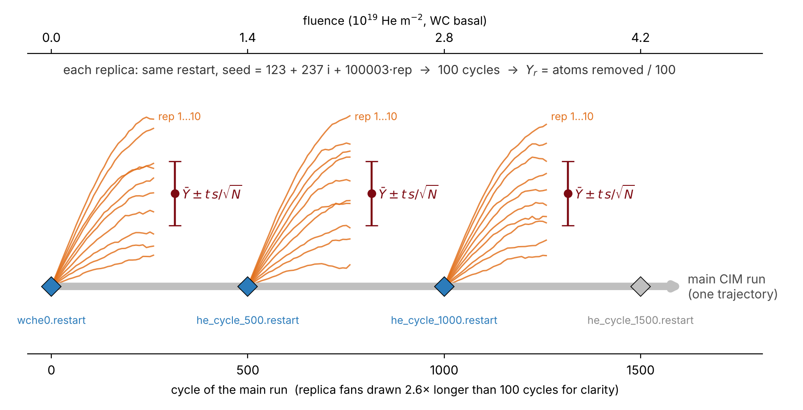

# CIM_statistics: seed replicas for CIM error bars

A main CIM run (see [`WC_CIM`](../WC_CIM)) gives a single history of the yield. These scripts branch short runs from its save points (`he_cycle_<N>.restart`), each differing only in the random seed. The scatter between seeds gives every CIM yield an error bar.



| File | Purpose |
|---|---|
| `in_CIM_rep.step2` | WC replica deck. The CIM step 2 with a `rep` seed offset and an optional start from `he_cycle_<N>.restart` |
| `in_W_CIM_rep.step2` | the same for pure W(001) (EAM4 + W–He, W = 1, He = 2, 739 K). With `rep 0` it is also the main W CIM deck. It needs `w0.restart` and the cycle-0 dumps from a W slab step 1, which is not in this repo |
| `setup_replicas.sh` | makes one folder per seed in every run folder |
| `submit_all.sh` | submits the waiting seeds as one array job of `-j` tasks, then the summary job |
| `run_replicas.slurm` | the array task: runs its seeds one after another (submitted by `submit_all.sh`) |
| `summarize.slurm`, `summarize_replicas.py` | yields, mean, SEM, 95 % CI per save point |
| `cim_replica_schematic.py` / `.ipynb` | the figure above |
| `summarize_replicas.ipynb` | notebook version of the summary |

## Layout

Make `potentials/` and `runs/` yourself; the scripts create everything marked *(made)*.

```
CIM_replicas/
├── potentials/                WCH.tersoff WHe.table CHe.table HeHe.table w_eam4.fs
├── runs/
│   ├── WC_basal_C_50eV/       wche0.restart he_cycle_500.restart he_cycle_1000.restart
│   │   ├── seed_b0000_s01/    (made) cycles 1-100 from wche0.restart
│   │   ├── seed_b0500_s01/    (made) cycles 501-600 from he_cycle_500.restart
│   │   ├── replica_yields.csv, replica_summary.csv, replica_yields.png   (made)
│   ├── W001_100eV/            w0.restart (+ he_cycle_<N>.restart)
│   └── all_replica_summary.csv   (made)
├── in_CIM_rep.step2  in_W_CIM_rep.step2
├── setup_replicas.sh  submit_all.sh  run_replicas.slurm  summarize.slurm  summarize_replicas.py
└── logs/                      (made) Slurm output and task lists
```

Folder naming rules:
- **Energy.** A run folder name must end in `_<E>eV`; the He energy is read from it.
- **Material.** `wche0.restart` means WC; `w0.restart` means W.
- **Save points.** Each `he_cycle_<N>.restart` present is a save point (default 0, 500, 1000). Missing ones are skipped.

## Setup (once)

- In `run_replicas.slurm`, edit the `EDIT` lines (account, module, `LMP`, cores, wall time) to match the main CIM jobs.
- In `summarize.slurm`, edit the `module load` line: a python3 with numpy; matplotlib is optional.
- After copying from Windows: `dos2unix *.sh *.slurm *.step2 *.py && chmod +x *.sh`.

## Run

```bash
./setup_replicas.sh          # 10 seeds x 100 cycles at save points 0/500/1000, all of runs/
./submit_all.sh -t           # test: first waiting seed only
# check that its cycle_time.dat reads 20.000 ps per cycle and note the time per seed, then:
./submit_all.sh -j 5         # remaining seeds in 5 jobs, then the summary job
```

| `setup_replicas.sh` option | Default | Meaning |
|---|---|---|
| `-n` | 10 | seeds per save point (max 99) |
| `-c` | 100 | cycles per seed |
| `-b` | `"0 500 1000"` | save points |
| `-d` | 50 | keep `dump.bulk/full` every N cycles |
| `-x` | – | extra LAMMPS args for every seed; must match the main run (e.g. `-x "-var Tsub 739"`) |
| `-f` | – | rebuild existing seed folders (only before they have run) |
| folders | all of `runs/` | limit to these run folders |

Existing seed folders are never touched. To add seeds, rerun with a larger `-n`, then `./submit_all.sh` again.

| `submit_all.sh` | Submits |
|---|---|
| `-t` | the first waiting seed only, no summary (test) |
| `-j 5` | all waiting seeds in 5 jobs, shared evenly |
| `-j 5 -r 2` | the same, at most 2 running at once |
| `-j 5 -T 72:00:00` | the same, with a 72 h wall time per job |
| `-j 4 runs/WC_prism_100eV` | only that run folder's seeds |
| `-n` / `-d` | no summary job / dry run |

How submission works:
- **Submission limit.** Every array task counts toward it. Check with `sacctmgr show assoc user=$USER format=user,maxsubmit`.
- **Never submitted twice.** Each submitted seed gets a `submitted` file. Seeds with that file or a `log.lammps` are skipped, so `submit_all.sh` can be rerun at any time.
- **Wall time.** A job with K seeds needs about K × one seed.
- **Job out of time.** The seed it was on stops part-way and the later seeds never start. To recover:
  1. Delete the interrupted seed's folder and rerun `./setup_replicas.sh`.
  2. Delete the `submitted` files of the seeds that never started.
  3. Rerun `./submit_all.sh`.

  `logs/tasks_<date>.txt` lists each job's seeds.

## Seeds

LAMMPS is given `rep = save point + s`. For example, `seed_b0500_s03` is rep 503, and the main run is rep 0.
- LAMMPS uses one random stream per run, seeded by the first `random()` call. The decks add `rep` to that seed.
- Seeds from the same save point therefore differ from the first impact on.
- Rerunning a seed folder reproduces it exactly.

## Results

The summary job runs after the array. It can also be run by hand at any time:

```bash
python3 summarize_replicas.py                       # all of runs/
python3 summarize_replicas.py runs/W001_100eV       # one run folder
python3 summarize_replicas.py --include-incomplete  # include unfinished seeds
```

How the statistics are computed:
- **Which yield.** The C yield for WC, and the W yield for pure W.
- **W from WC.** Only a few atoms per seed, so it is pooled and given as a 95 % upper limit.
- **Cycle check.** A warning is printed for any cycle that is not 20 ps.

| `replica_summary.csv` | Meaning |
|---|---|
| `branch` | save point |
| `n_seeds`, `n_incomplete` | seeds used / unfinished |
| `window_centre_cycle`, `fluence_centre_m2` | window position. Impact areas: basal 3567, prism 3420, W 3490 Ų |
| `Y_mean`, `Y_SD`, `Y_SEM`, `Y_CI95` | yield (atoms/He); the CI uses Student t |
| `dispersion` | var/mean of the counts (1 = Poisson, > 1 = bursty) |
| `seeds_for_10pct_SEM` | seeds needed for a 10 % SEM; add seeds where it exceeds `n_seeds` |
| `W_total`, `impacts_total`, `Y_W_pooled`, `Y_W_95UL` | pooled W yield and 95 % upper limit |

`replica_yields.csv` has one row per seed: cycles, W and C sputtered, yields, a complete flag, and the cycle-length check.

## How many seeds

Rough starting points from the main WC runs; `seeds_for_10pct_SEM` refines them after the first round.

| Surface | 50 / 100 / 200 eV |
|---|---|
| basal, C-terminated | 17 / 8 / 13 |
| basal, W-terminated | 51 / 25 / 18 (use `-n 20`, or `-c 200`) |
| prism | 13 / 6 / 11 |

For W(001) at 100 eV, sputtering is so rare (one atom in ~400 cycles) that seeds give only an upper limit. They become useful at 200 eV.
