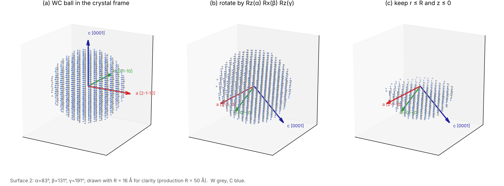

# SIM_random: random-orientation single-impact model

The method follows Jussila, Granberg & Nordlund, *Nucl. Mater. Energy* 17 (2018) 113:
1. Rotate a crystal by random Euler angles.
2. Cut a hemisphere whose flat face is the irradiated surface.
3. Average the yield over many orientations.

The average stands for a polycrystal with random grain orientations. W is the benchmark against Jussila; WC is the production case.



| File | Purpose |
|---|---|
| `in_rand_W.step1`, `in_rand_WC.step1` | build surface `s`. See the step list below the table |
| `in_rand_W.step2`, `in_rand_WC.step2` | `nimp` single impacts on that surface (each re-reads the restart); one line per impact |
| `run_rand.slurm` | array job, task ID = surface ID: step 1, then step 2 at each energy |
| `analyze_rand.py` / `.ipynb` | per-surface yields, mean ± SEM over surfaces (as in Jussila), the "clean" mean, yield on an inverse pole figure |
| `rand_schematics.py` / `.ipynb` | the schematics in `figs/`, rebuilt with the decks' own geometry and random stream |
| `rand_surface_views.py` / `.ipynb` | regular vs random surface: the cut through the unrotated crystal, and top views |
| `rand_orientation_gif.py` / `.ipynb` | GIF with one frame per surface, drawn in the unrotated lattice, with Miller labels |
| `rand_geom.py` | shared geometry: lattices, rotation, hemisphere cut, Miller labels (cubic and 4-index hexagonal) |
| `rand_angles_lammps.csv` | Euler angles and origin shifts of surfaces 1–500 from the LAMMPS random stream, so the figures need no LAMMPS Python module |

Step 1 (`in_rand_*.step1`) builds the surface in five stages:
1. Make a crystal ball.
2. Rotate it by Rz(γ) Rx(β) Rz(α).
3. Keep r ≤ R, z ≤ 0.
4. Split it into fixed, thermostat and NVE shells.
5. Minimize, run 10 ps at T, and write the restart.

The decks target LAMMPS 29Oct2020. Run them with `-in`.

## Run

```bash
# folder with the decks + potentials (W: w_eam4.fs WHe.table HeHe.table; WC: WCH.tersoff WHe.table CHe.table HeHe.table)
sbatch --array=1-50 run_rand.slurm WC                                        # 50 random WC surfaces
sbatch --array=1-50 run_rand.slurm W                                         # 50 random W surfaces
sbatch --array=1-30 run_rand.slurm WC bas "-var beta 0 -var gamma 0"         # basal references
sbatch --array=1-50 run_rand.slurm W r "-var T 300 -var R 35 -var a 3.152"   # Jussila set-up
python analyze_rand.py --mat WC --dir .                                      # CSVs + IPF plots
```

`run_rand.slurm` takes three arguments:
- **Material.** `W` or `WC`.
- **Set tag.** Defaults to `r`.
- **Extra LAMMPS args.** Passed to both steps.

Set the energies (`ENERGIES`, default 50 100 200) and `NIMP` (1000) inside it, and edit the `EDIT` lines. Time a 20-impact pilot first.

Defaults: T = 739 K (W) or 614.6 K (WC), i.e. 0.2 T<sub>m</sub>; R = 50 Å; θ = 30°.

## Orientation sampling

- **Euler angles (ZXZ).** α and γ are uniform on 0–360°. β = arccos(2u − 1), which gives a uniform distribution over orientations.
- **Origin shift.** A random shift in [0, 1)³ samples every termination and step position. For WC this decides whether C or W is on top.
- **Logged per surface.** `rand_<MAT>_surfaces.dat` holds:
  - the Euler angles;
  - the surface normal in the crystal frame, n = (sin β sin γ, sin β cos γ, cos β);
  - the origin shift and the atom counts;
  - z<sub>s</sub> and, for WC, the C fraction of the top layer.
- **Low-index references.** Override the angles; the azimuth stays random.
  - W: (001) `-var beta 0 -var gamma 0`; (011) `-var beta 45 -var gamma 0`; (111) `-var beta 54.7356 -var gamma 45`.
  - WC: basal `-var beta 0 -var gamma 0`; prism (10-10) `-var beta 90 -var gamma 0`; a-plane (11-20) `-var beta 90 -var gamma 90`.
- **Random numbers.** LAMMPS keeps one random stream per run, seeded by the first `random()` call. The decks put the surface ID (and the energy) into that seed, so rerunning `s` rebuilds the same surface.

## What counts as sputtered

Sputtered = `cap` + `end` + `lost`:
- **`cap`.** The atom crossed the capture plane z<sub>s</sub> + 18 Å. It is counted and deleted at once, as in the CIM decks.
- **`end`.** The atom is above z<sub>s</sub> + d<sub>cut</sub> when the impact ends. W uses 5.5 Å (the EAM cutoff; Jussila's criterion). WC uses 3.8 Å for W and 3.0 Å for C (Tersoff R + D).
- **`lost`.** The atom left the box between checks.

Timing and flags:
- **Impact length.** Each impact runs until the He has thermalized or left, plus `t_settle` = 2 ps, capped at 10 ps. A reflected He does not end the count early.
- **`hit_fixed` = 1.** Marks impacts whose He reached the fixed shell. Jussila uses these as the lower error bar; `analyze_rand.py` also reports the mean without them.

## W benchmark against Jussila

Jussila's energies are 200/300/500/1000 eV. W sputtering at 200 eV is rare (about 1 per 1000 impacts), so include 500 eV.
- **Runs.** 50 random surfaces × 1000 impacts at θ = 30°.
  - Jussila set-up: `-var T 300 -var R 35 -var a <a at 300 K>`.
  - Production set-up: 0.2 T<sub>m</sub>, R = 50 Å.
- **Sanity check.** At 50 and 100 eV the W yield should be zero (below threshold).

Approximate targets (random-surface average, θ = 30°, read from Jussila Fig. 6, ±20 %):

| E (eV) | 200 | 300 | 500 | 1000 |
|---|---|---|---|---|
| Y<sub>W</sub> | ≈ 1.2 × 10⁻³ | ≈ 7 × 10⁻³ | ≈ 2 × 10⁻² | ≈ 4 × 10⁻² |

Differences to state when comparing:

| | Jussila 2018 | These decks |
|---|---|---|
| W–W | Marinica EAM + short-range modification | EAM4 (`w_eam4.fs`) |
| He–W | ZBL | Juslin–Wirth table |
| Electronic stopping | friction above 10 eV | none |
| Thermostat shell | Berendsen | Nosé–Hoover |
| Code | PARCAS | LAMMPS |

## WC at 50/100/200 eV

1. **Pilot.** About 10 surfaces × 200 impacts at 100 eV, to measure the surface-to-surface spread σ<sub>s</sub> and the time per impact.
2. **Precision estimate.** With N<sub>s</sub> surfaces of N<sub>i</sub> impacts each,

   SEM² ≈ σ<sub>s</sub>²/N<sub>s</sub> + D·Ȳ/(N<sub>i</sub>N<sub>s</sub>),

   where D ≈ 1–2.5 is the burstiness of C sputtering seen in the CIM runs.
   - **C yield (~0.2).** N<sub>s</sub> sets the precision. With σ<sub>s</sub>/Ȳ ≈ 0.3, 40 surfaces give about 5 %.
   - **W yield.** A few events per 1000 impacts, so report it pooled with a Poisson upper limit.
3. **Reference sets.** Run the basal, prism and a-plane references with the same deck. They are low-index SIM points that use the same sputtering criterion as the CIM.
4. **Covariates.** Plot the yield against the surface normal (IPF) and against the top-layer C fraction. This separates the effect of orientation from that of termination.
